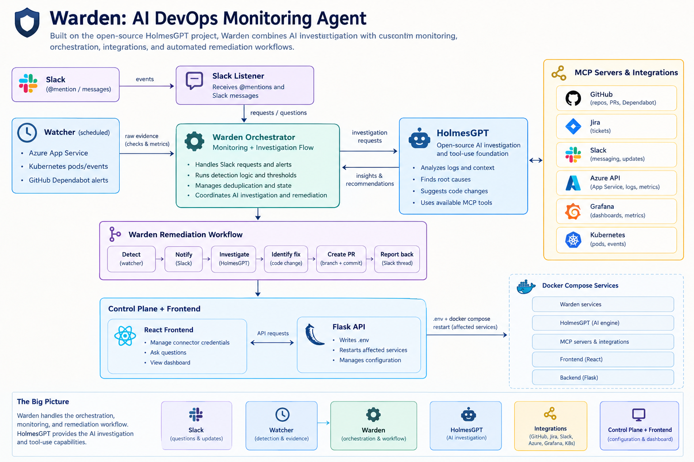

# Warden: AI DevOps Monitoring Agent

Warden is an AI-powered DevOps monitoring and automation platform built on the open-source [HolmesGPT](https://github.com/robusta-dev/holmesgpt) project. It combines HolmesGPT's AI-powered investigation capabilities with custom monitoring, event detection, orchestration, integrations, and automated remediation workflows.

Warden orchestrates a set of MCP servers and integrations (GitHub, Jira, Slack, Azure, Grafana, and Kubernetes) to investigate infrastructure issues, answer questions in Slack, and proactively detect problems. When an issue is identified, Warden can initiate an investigation, trace potential root causes to the codebase, and open a pull request with a proposed fix for human review.

## Architecture


## What it does

### 1. Reactive investigation

Mention Warden in Slack and ask questions such as:

- "List open GitHub PRs."
- "Are all Kubernetes pods healthy?"
- "Show Jira tickets in progress."

The Slack listener forwards the request into Warden's investigation workflow. HolmesGPT provides the underlying AI-powered reasoning and tool-use capabilities, using the configured MCP servers and integrations to gather information and formulate a response.

### 2. Proactive monitoring and detection

Warden's custom `watcher` service periodically checks infrastructure and repository signals. It evaluates raw evidence before invoking an AI investigation, avoiding unnecessary LLM calls when everything appears healthy.

**Azure App Service**
- Application state and availability.
- HTTP 5xx error rates.
- Real exception tracebacks extracted from application logs.

**Kubernetes**
- `CrashLoopBackOff`, `ImagePullBackOff`, and `OOMKilled` conditions.
- High pod restart counts.
- Recent Kubernetes Warning events.

**Security**
- Open GitHub Dependabot alerts at or above a configurable severity.
- Configurable limits on the number of new alerts escalated per polling cycle.

The watcher is responsible for scheduled checks, issue detection, thresholds, and deduplication. It gathers evidence using Azure CLI, `kubectl`, and the GitHub REST API rather than asking the LLM to continuously poll infrastructure.

### 3. AI-assisted root-cause analysis and remediation

When Warden detects a problem, it initiates the remediation workflow:

1. **Detect:** The watcher identifies an issue and records the relevant evidence.
2. **Notify:** Warden posts an alert to Slack.
3. **Investigate:** The workflow invokes HolmesGPT to investigate the issue using available tools, repository context, logs, and infrastructure information.
4. **Identify a potential fix:** The AI investigation identifies a likely root cause and proposes a code change when the issue is fixable.
5. **Create a pull request:** The configured workflow creates a branch, commits the proposed change, and opens a pull request.
6. **Report back:** Warden posts the pull request link to the originating Slack thread for human review.

**Safety boundary:** Warden does not automatically merge pull requests. Proposed fixes remain subject to human review.

The monitoring logic, detection thresholds, event routing, deduplication, remediation workflow, and control plane are Warden components. HolmesGPT is used as the underlying AI investigation and tool-use component within this larger system.

### 4. Control plane and frontend

Warden includes a React frontend and Flask control-plane API for managing integrations without manually editing environment files.

The interface supports:
- Managing connector credentials for GitHub, Jira, Slack, Grafana, and Azure.
- Asking questions through the configured investigation workflow.
- Viewing the Warden dashboard and operational status.

The Flask API updates the relevant `.env` settings and restarts only the affected Docker Compose services when connector configuration changes.

## Project structure

```text
Warden/
├── docker-compose.yaml             # Main service orchestration
├── config.yaml                     # HolmesGPT model and tool configuration
├── holmes-custom/                  # Customized HolmesGPT image
│   └── Azure CLI and kubectl-safe az wrapper
├── slack-listener/                 # Slack events and @mention handling
├── watcher/                        # Custom scheduled monitoring and detection
├── watcher-data/                   # Persisted deduplication state
│   └── watcher_state.json
└── backend/                        # Warden control plane and React frontend
    ├── app.py                      # Flask API, environment updates, restarts
    ├── App.jsx                     # Connectors, Ask Holmes, dashboard
    ├── main.jsx
    └── docker-compose.yaml
```

### Component responsibilities

| Component | Responsibility |
|---|---|
| Warden watcher | Scheduled checks, thresholds, issue detection, and deduplication |
| Slack listener | Receives Slack mentions and routes questions into the investigation workflow |
| HolmesGPT | Open-source AI investigation and tool-use foundation |
| MCP servers and integrations | Provide access to GitHub, Jira, Slack, Azure, Grafana, and Kubernetes |
| Warden remediation workflow | Coordinates investigation outcomes, pull-request creation, and Slack updates |
| Flask control plane | Manages connector configuration and service restarts |
| React frontend | Provides the configuration interface, question entry point, and dashboard |

## Prerequisites

- Docker Desktop. Enable Kubernetes in Docker Desktop if you want to use the Kubernetes workflow.
- A Gemini API key from [Google AI Studio](https://ai.google.dev). Check the model IDs available to your account before configuring HolmesGPT.
- A GitHub Personal Access Token with repository access and, if using security scanning, `security_events` for a classic token or the appropriate Dependabot alerts read permission for a fine-grained token.
- A Slack app with Socket Mode enabled. You need both a bot token (`xoxb-...`, from OAuth & Permissions) and an app-level token (`xapp-...`, from App-Level Tokens, with the `connections:write` scope).
- An Azure subscription and service principal, if using Azure monitoring.

## Quick setup

### 1. Configure environment variables

Create a `.env` file in the project root:

```bash
GEMINI_API_KEY=...
GITHUB_TOKEN=ghp_...
GITHUB_REPO=your-org/your-repo

SLACK_TOKEN=xoxb-...
SLACK_APP_TOKEN=xapp-...
SLACK_CHANNEL=your-alerts-channel

AZURE_APP_SERVICE=your-app-name
AZURE_RESOURCE_GROUP=your-resource-group
AZURE_SUBSCRIPTION_ID=...
AZURE_TENANT_ID=...
AZURE_CLIENT_ID=...
AZURE_CLIENT_SECRET=...

K8S_ENABLED=true
K8S_NAMESPACE=default

SECURITY_ENABLED=true
SECURITY_MIN_SEVERITY=high
```

The model and tool settings are configured through `config.yaml` and the relevant environment variables expected by the Warden services and HolmesGPT.

### 2. Configure Kubernetes

- Enable Kubernetes in Docker Desktop or configure access to an existing cluster.
- Confirm connectivity:

```bash
kubectl get nodes
```

The `watcher` and HolmesGPT containers need read-only access to your kubeconfig:

```yaml
volumes:
  - ~/.kube/config:/tmp/.kube/config:ro
```

At startup, both containers copy the configuration and rewrite `localhost` or `127.0.0.1` endpoints to `host.docker.internal` where needed. This allows containers to reach the Kubernetes API exposed by Docker Desktop on the host.

The watcher then polls the configured namespace for pod health and Kubernetes events.

### 3. Start Warden

From the project root:

```bash
docker compose up -d --build
docker compose ps
```

Check that the required services are running and that the HolmesGPT container reports healthy status where a health check is configured.

### 4. Start the control plane and frontend (optional)

Start the Flask API:

```bash
cd backend
pip install -r requirements.txt

export CONTROL_PLANE_TOKEN=<pick-a-token>
python app.py
```

The API serves on port `4000`.

In a separate terminal, start the React development server:

```bash
npm install
npm run dev
```

The frontend serves on port `5173`.

## Testing the workflow

A minimal, intentionally buggy FastAPI application is available here:

**[Warden test application](https://github.com/PriyanshiGupta1701/warden-test)**

It exposes two endpoints that generate genuine unhandled exceptions:

- `/items/{id}` — raises `KeyError` when an item does not exist.
- `/divide/{n}` — raises `ZeroDivisionError` when `n=5`.

These errors provide evidence for testing the log-scanning, investigation, and proposed-fix workflows.

### Test Azure monitoring

Deploy the test application to your Azure App Service. Follow the test repository's README for the GitHub Actions deployment setup, including the Azure basic-auth configuration or OIDC `azure/login` alternative, and the `SCM_DO_BUILD_DURING_DEPLOYMENT=true` app setting.

Trigger the errors:

```bash
curl https://<your-app>.azurewebsites.net/items/99
curl https://<your-app>.azurewebsites.net/divide/5
```

Wait for the next watcher polling cycle, or restart the watcher to initiate another cycle:

```bash
docker compose restart watcher
```

Check Slack for the alert and resulting investigation thread.

### Test Kubernetes monitoring

Build and deploy the same application to a local Kubernetes cluster:

```bash
docker build -t warden-test:local .

kubectl create deployment warden-test \
  --image=warden-test:local \
  -n default

kubectl expose deployment warden-test \
  --port=80 \
  --target-port=8000 \
  -n default

kubectl port-forward svc/warden-test 8080:80 -n default
```

Trigger an application error:

```bash
curl http://localhost:8080/items/99
```

Application errors alone do not necessarily trigger the pod-health checks. To test those checks, deliberately introduce a pod-level problem in a non-production environment, such as deploying an invalid image tag to trigger `ImagePullBackOff` or configuring a restrictive memory limit to exercise the `OOMKilled` path.

Wait for the next watcher cycle and check Slack for the alert, investigation, and any proposed pull request.

## Configuration reference

| Variable | Default | Purpose |
|---|---|---|
| `POLL_INTERVAL_SEC` | `300` | Frequency of watcher checks |
| `CHECK_WINDOW_MINUTES` | `15` | Lookback window for Azure metrics and Kubernetes events |
| `LOG_WINDOW_MINUTES` | `20` | Lookback window for Azure log scanning |
| `HTTP_5XX_THRESHOLD` | `1` | Minimum 5xx count in the lookback window to flag an issue |
| `K8S_POD_RESTART_THRESHOLD` | `5` | Restart count that qualifies as high |
| `SECURITY_MIN_SEVERITY` | `high` | Minimum Dependabot severity to escalate: `low`, `medium`, `high`, or `critical` |
| `SECURITY_MAX_NEW_ALERTS_PER_CYCLE` | `1` | Maximum new security alerts escalated per polling cycle |
| `LITELLM_NUM_RETRIES` | `3` (configured as `8` in this setup) | Number of automatic LiteLLM retries when requests encounter rate limits |

## How Warden keeps LLM costs low

Warden uses a detection-first approach.

- **Direct monitoring:** The watcher calls Azure CLI, `kubectl`, and the GitHub REST API to collect evidence.
- **Threshold-based detection:** Issues are identified using configurable metrics, health conditions, and severity thresholds.
- **Deduplication:** Persisted watcher state prevents repeatedly escalating the same issue.
- **Selective AI investigation:** HolmesGPT is invoked when a request needs AI reasoning or when detected evidence warrants further investigation.
- **Structured security checks:** Dependabot alerts are already structured, so Warden can filter them by severity without an LLM call. AI investigation is reserved for relevant code-level analysis and potential fixes.

This design separates deterministic monitoring from AI-driven investigation. Routine polling does not require continuous LLM calls, while HolmesGPT supplies the reasoning and tool-use capabilities needed when deeper investigation is warranted.

## Technology foundation

Warden is built by combining an open-source AI investigation foundation with custom DevOps automation components.

- **HolmesGPT:** AI-powered investigation and tool-use foundation.
- **Python and Flask:** Control-plane API and backend services.
- **React:** Configuration interface and dashboard.
- **Docker Compose:** Service orchestration.
- **MCP servers and APIs:** Connectivity to development, collaboration, cloud, and infrastructure systems.
- **Azure and Kubernetes:** Infrastructure monitoring targets.
- **GitHub:** Repository investigation, Dependabot scanning, and pull-request creation.
- **Slack:** Interactive questions, alerts, and investigation updates.

**In short:** HolmesGPT provides the AI investigation capabilities; Warden builds the monitoring, orchestration, alerting, control plane, and human-reviewed remediation workflow around them.

